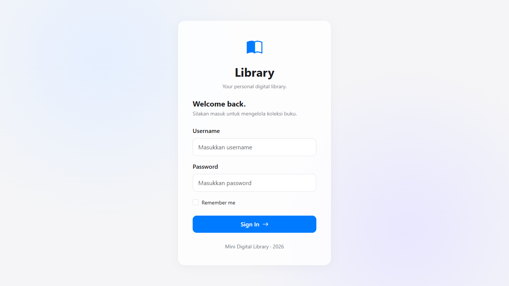
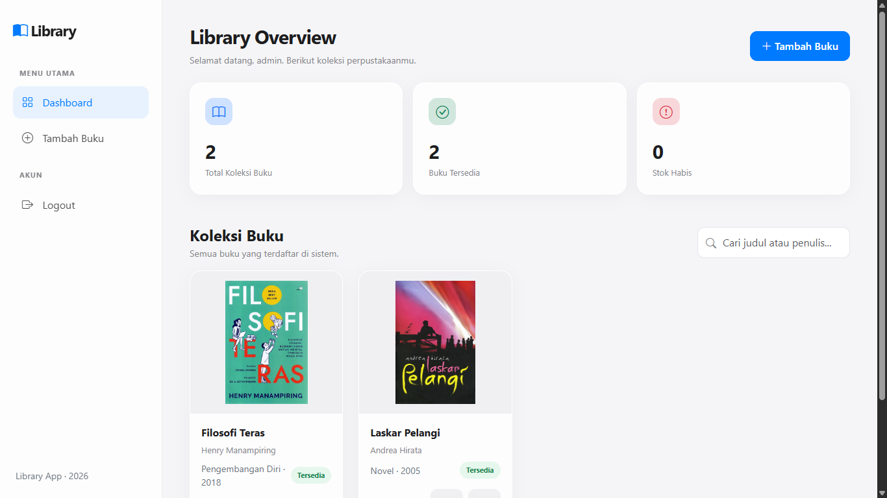
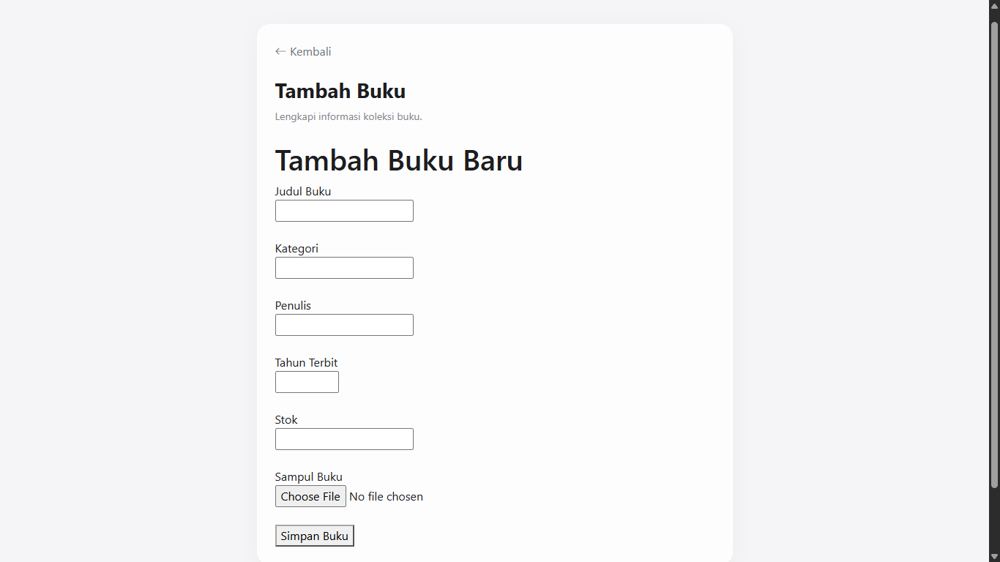
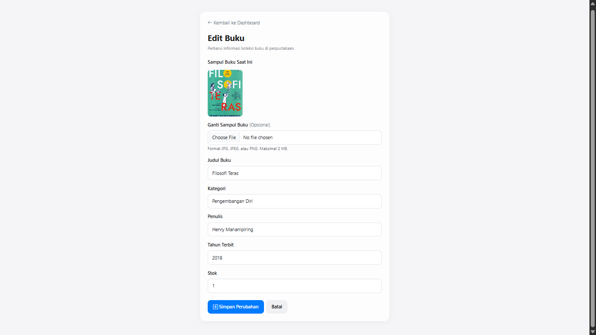
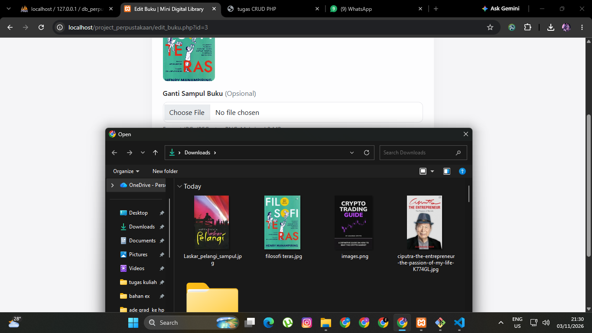
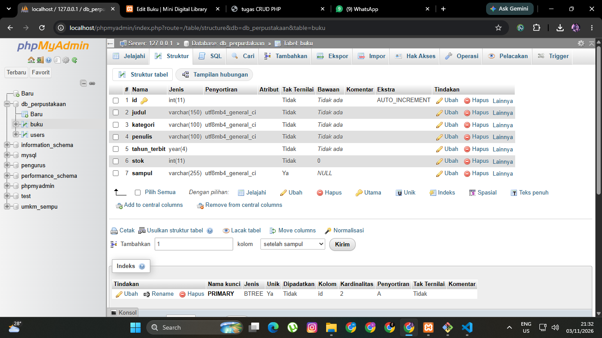
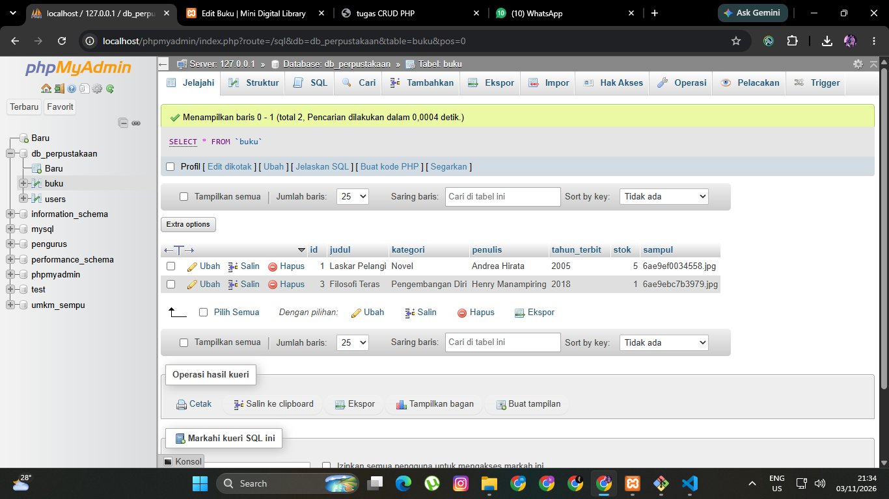

# 📚 Mini Digital Library

**Sistem Informasi Perpustakaan Digital Mini**

Aplikasi perpustakaan digital sederhana berbasis web yang dikembangkan menggunakan PHP Native dan MySQL. Aplikasi ini digunakan untuk mengelola data buku, autentikasi admin, serta ketersediaan buku melalui sistem CRUD (Create, Read, Update, Delete).

---

## 👨‍💻 Identitas Project

| Keterangan | Detail |
|---|---|
| Nama Project | Mini Digital Library |
| Mata Kuliah | Pemrograman Web |
| Program Studi | Sistem Informasi |
| Universitas | Universitas Nusantara PGRI Kediri |
| Nama Mahasiswa | Kevin Alvaro Wisar |
| NPM | 2513020087 |
| Bahasa Pemrograman | PHP Native |
| Database | MySQL |
| Framework CSS | Bootstrap 5 |
| Tools | Visual Studio Code, XAMPP, phpMyAdmin |

---

## 📖 Deskripsi Project

Mini Digital Library merupakan aplikasi berbasis web yang dirancang untuk membantu pengelolaan data buku dalam sebuah perpustakaan sederhana.

Aplikasi ini menyediakan sistem autentikasi admin, pengelolaan data buku, upload gambar sampul, serta informasi status ketersediaan buku.

Project ini dikembangkan sebagai implementasi materi pemrograman web, khususnya penggunaan PHP Native, database MySQL, session, cookie, dan operasi CRUD.

## ✨ Fitur Aplikasi

### 1. Autentikasi Admin
- Login menggunakan username dan password.
- Validasi password menggunakan `password_verify()`.
- Penggunaan session untuk membatasi akses halaman.
- Fitur Remember Me menggunakan cookie.
- Logout dengan penghapusan session dan cookie.

### 2. Manajemen Data Buku (CRUD)
- Menambahkan data buku.
- Menampilkan daftar buku.
- Mengedit informasi buku.
- Menghapus data buku.

### 3. Upload Sampul Buku
- Upload gambar sampul buku.
- Mendukung format JPG, JPEG, dan PNG.
- Validasi ukuran file maksimal 2 MB.
- Menyimpan file gambar pada folder server.
- Menyimpan nama file gambar ke database.
- Menghapus gambar terkait ketika data buku dihapus.

### 4. Status Ketersediaan Buku
Status ketersediaan buku ditentukan berdasarkan jumlah stok:

| Kondisi Stok | Status |
|---|---|
| Stok lebih dari 0 | Tersedia |
| Stok sama dengan 0 | Dipinjam |

### 5. Tampilan Antarmuka
- Desain antarmuka modern dan minimalis.
- Menggunakan Bootstrap 5.
- Menggunakan CSS untuk penyesuaian tampilan.
- Menggunakan JavaScript untuk interaksi antarmuka.

---

## 🖥️ Screenshot Aplikasi

Berikut merupakan dokumentasi tampilan aplikasi Mini Digital Library.

### 1. Halaman Login



### 2. Dashboard Admin



### 3. Halaman Tambah Buku



### 4. Halaman Edit Buku



### 5. Fitur Upload Sampul Buku



### 6.  Struktur Database Buku



### 7. Database Buku 



---

## 🗄️ Struktur Database

Project ini menggunakan database MySQL dengan nama `db_perpustakaan`.

### Tabel `users`

Tabel ini digunakan untuk menyimpan informasi akun admin.

| Nama Kolom | Tipe Data | Keterangan |
|---|---|---|
| id | INT | Primary Key, Auto Increment |
| username | VARCHAR(50) | Username admin |
| password | VARCHAR(255) | Password yang telah di-hash |

### Tabel `buku`

Tabel ini digunakan untuk menyimpan informasi buku.

| Nama Kolom | Tipe Data | Keterangan |
|---|---|---|
| id | INT | Primary Key, Auto Increment |
| judul | VARCHAR(150) | Judul buku |
| kategori | VARCHAR(100) | Kategori buku |
| penulis | VARCHAR(100) | Nama penulis |
| tahun_terbit | YEAR | Tahun terbit |
| stok | INT | Jumlah stok buku |
| sampul | VARCHAR(255) | Nama file gambar sampul |

---

## 📁 Struktur Folder Project

```text
project_perpustakaan/
│
├── config/
│   └── auth.php
│
├── setup/
│   └── PENJELASAN_BUAT_ADMIN.txt
│
├── uploads/
│   └── (file sampul buku)
│
├── screenshots/
│   └── (dokumentasi screenshot)
│
├── index.php
├── koneksi.php
├── proses_login.php
├── buat_admin.php
├── dashboard.php
├── tambah_buku.php
├── proses_tambah.php
├── edit_buku.php
├── proses_edit.php
├── hapus_buku.php
├── logout.php
├── style.css
├── script.js
│
├── db_perpustakaan.sql
└── README.md
```

---

## ⚙️ Instalasi dan Konfigurasi

Ikuti langkah-langkah berikut untuk menjalankan aplikasi secara lokal.

### 1. Persiapan Tools

Pastikan perangkat telah memiliki:
- XAMPP.
- Web browser.
- Visual Studio Code (opsional).

### 2. Menempatkan Folder Project

Salin folder `project_perpustakaan` ke dalam direktori:

```text
C:\xampp\htdocs\
```

### 3. Menjalankan XAMPP

Aktifkan layanan:
- Apache
- MySQL

### 4. Membuat Database

1. Buka browser.
2. Akses `http://localhost/phpmyadmin`.
3. Buat database dengan nama `db_perpustakaan`.
4. Pilih menu Import.
5. Pilih file `db_perpustakaan.sql`.
6. Klik Import untuk menjalankan struktur dan data database.

### 5. Konfigurasi Koneksi

Pastikan konfigurasi database pada `koneksi.php` sesuai dengan pengaturan MySQL lokal.

### 6. Membuat Akun Admin

Jalankan prosedur inisialisasi akun admin satu kali menggunakan file `buat_admin.php` sesuai petunjuk pada folder `setup`.

Setelah akun berhasil dibuat, nonaktifkan atau hapus akses publik ke file inisialisasi tersebut.

### 7. Menjalankan Aplikasi

Buka browser dan akses:

```text
http://localhost/project_perpustakaan/
```

Login menggunakan akun admin yang telah dibuat.

---

## 🔐 Keamanan Aplikasi

Beberapa mekanisme keamanan yang diterapkan:
- Password disimpan menggunakan metode hashing.
- Autentikasi menggunakan PHP Session.
- Proteksi halaman untuk pengguna yang belum login.
- Validasi tipe dan ukuran file upload.
- Penggunaan prepared statement untuk query database yang menggunakan parameter.

---

## 🎥 Video Demonstrasi

Video demonstrasi aplikasi dapat dilihat melalui tautan berikut:

**YouTube:** -

Video demonstrasi mencakup:
- Proses login dan logout.
- Tampilan dashboard.
- Proses menambahkan buku.
- Proses mengedit buku.
- Proses menghapus buku.
- Proses upload sampul buku.
- Pengujian status ketersediaan buku.

---

## 📌 Repository GitHub

Source code dan database project tersedia melalui repository GitHub berikut:

**GitHub:** -

---

## 📝 Penutup

Mini Digital Library dikembangkan sebagai implementasi pembelajaran pemrograman web menggunakan PHP Native dan MySQL.

Melalui project ini, diharapkan dapat memahami penerapan autentikasi, pengelolaan session dan cookie, operasi CRUD, upload file, serta integrasi aplikasi web dengan database.

---

**© 2026 Mini Digital Library — Kevin Alvaro Wisar**